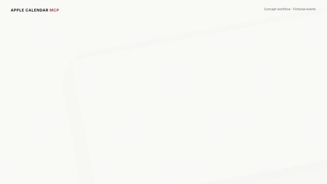

# Apple Calendar MCP

A read-only Apple Calendar plugin for Codex. Ask about your schedule, search event titles, and find free time in selected calendars.

[](https://github.com/Jackylwl/apple-calendar-mcp/raw/refs/heads/main/plugins/apple-calendar-mcp/media/apple-calendar-mcp.mp4)

## Install

Requires macOS 14+, Xcode Command Line Tools (`xcode-select --install`), and Codex with local plugin support.

```sh
codex plugin marketplace add Jackylwl/apple-calendar-mcp
codex plugin add apple-calendar-mcp@apple-calendar-mcp
```

The server compiles automatically on first start. Reload Codex if the tools do not appear.

You can also ask Codex:

> Install Apple Calendar MCP from https://github.com/Jackylwl/apple-calendar-mcp and verify its three tools. Ask me before requesting Calendar access.

## Connect your calendars

After installation, run this command when you are ready to grant Calendar access:

```sh
"$HOME/Library/Application Support/LocalAppleCalendar/calendar-mcp" --request-access
```

Use `list_calendars` in Codex, then save your selected calendar IDs as a JSON array in `~/Library/Application Support/LocalAppleCalendar/allowed-calendars.json`:

```json
["YOUR_CALENDAR_ID"]
```

An empty selection blocks event queries. macOS requires **Full Access**; this plugin enforces read-only behavior in code.

## Use

- “What is on my calendar tomorrow?”
- “Find my team meetings this month.”
- “Find a free hour next week using my selected calendars.”

| Tool | Purpose |
| --- | --- |
| `list_calendars` | List calendar names and IDs for selection |
| `read_events` | Read events within a date range |
| `search_events` | Search event titles within a date range |

## Privacy and limits

- No event creation, changes or deletion. Results contain titles, start/end times, calendar names and an all-day flag; notes, attendees and locations are not accessed.
- Calendar results enter your Codex conversation. The server runs locally over stdio, with no public network port or event cache.
- Queries cover up to 31 elapsed days and return up to 500 events. Narrow truncated results before inferring free time.
- Output defaults to `Asia/Hong_Kong`; pass `timezone` to change it. All-day end dates are exclusive.
- The Mac must be available. Results depend on the local Calendar store and account synchronization.

See [configuration and troubleshooting](plugins/apple-calendar-mcp/README.md) for details.

## Development

```sh
python3 -m unittest discover -s plugins/apple-calendar-mcp/tests -v
./plugins/apple-calendar-mcp/scripts/build.sh
python3 scripts/package.py /path/to/release-output
```

Tests use synthetic data and a separate backend without EventKit access.
